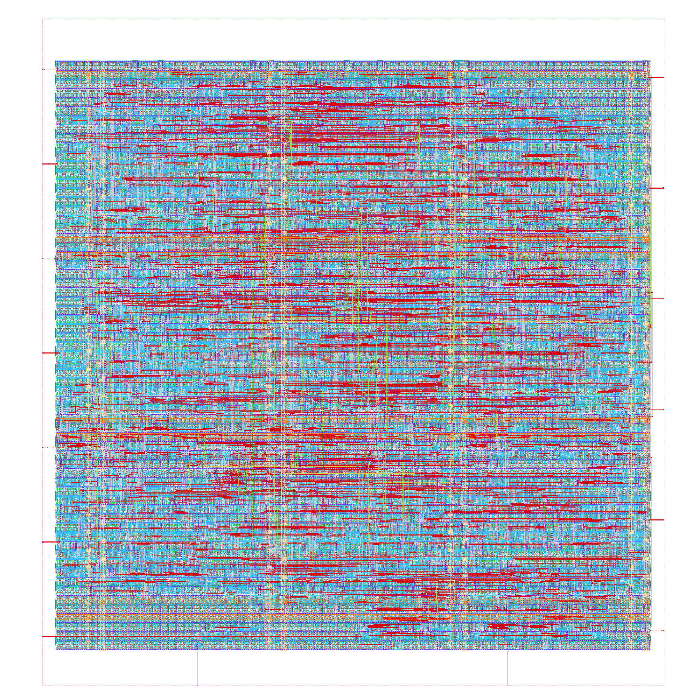
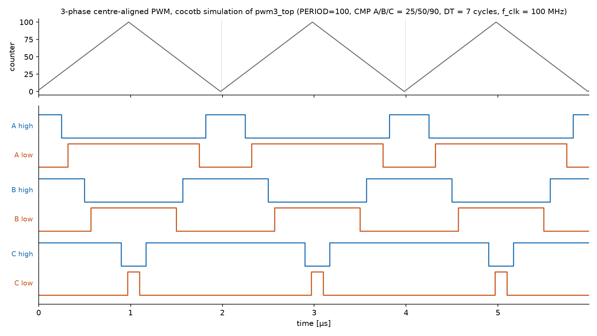
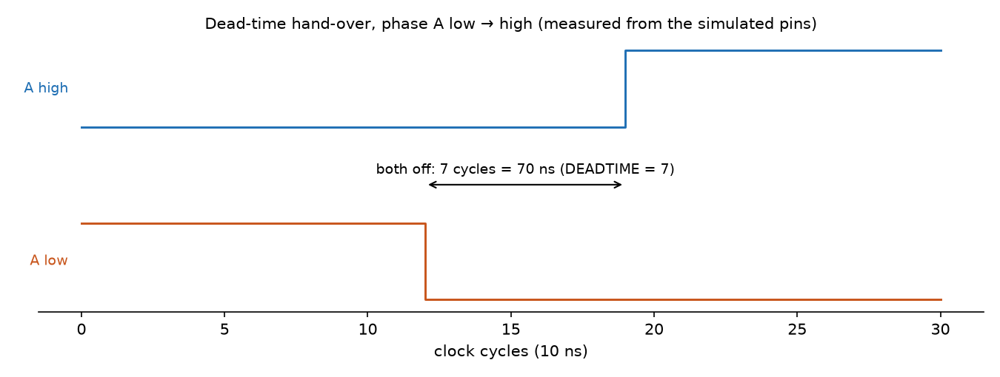
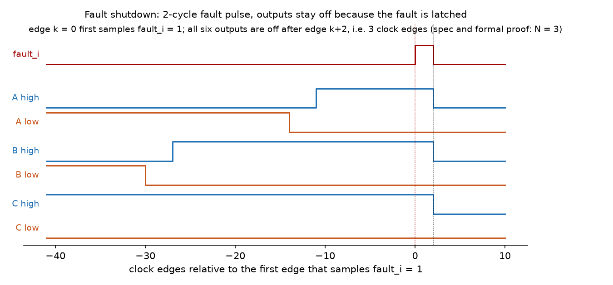
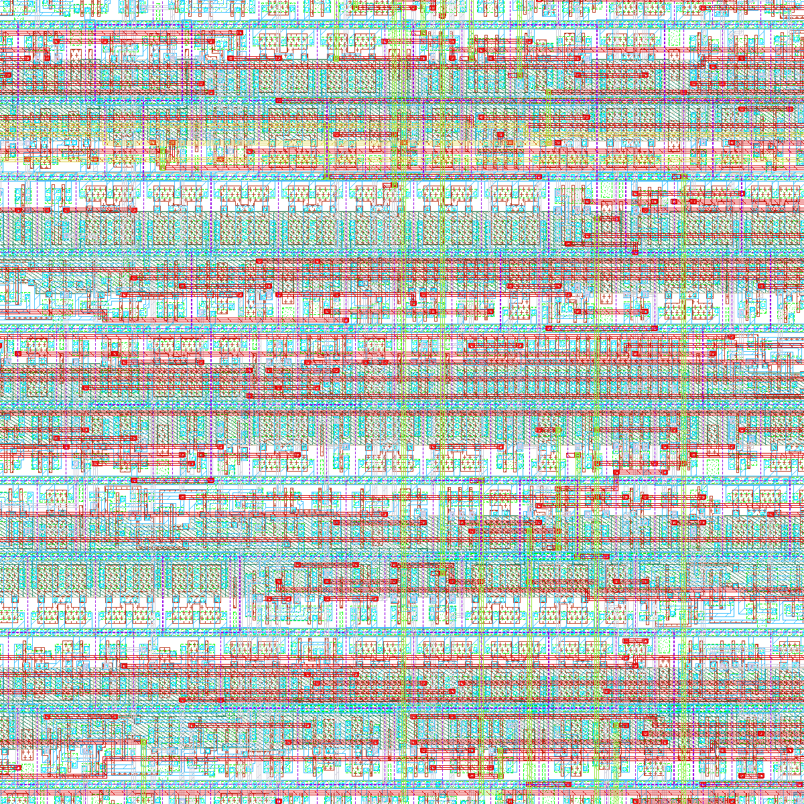
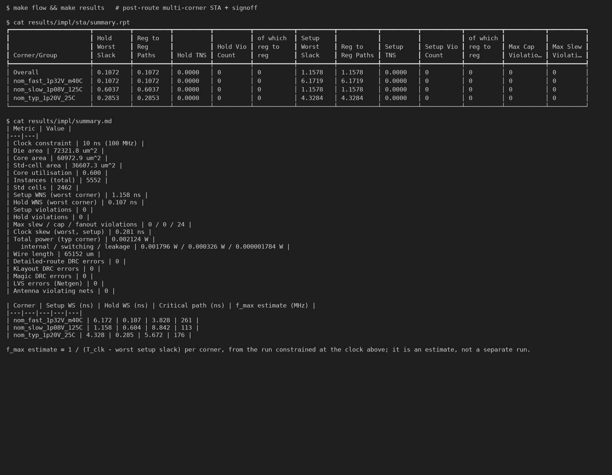
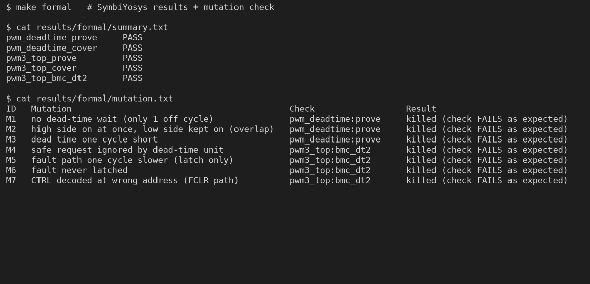
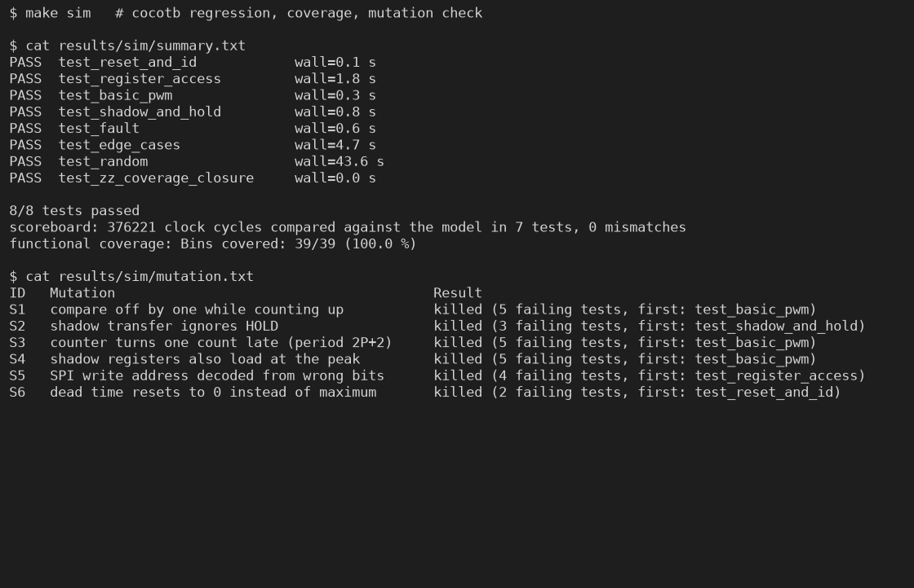
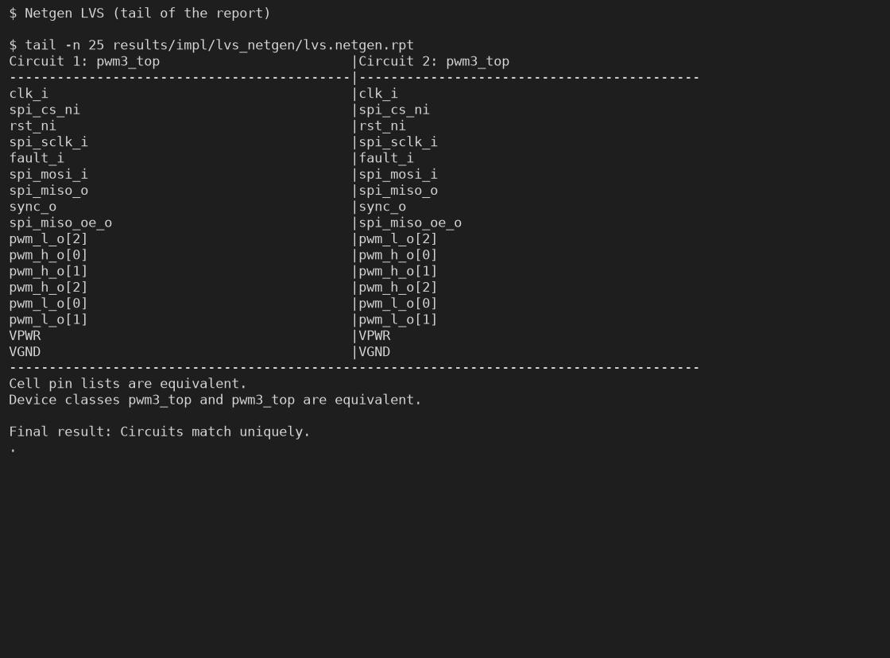

# pwm3_top — 3-phase PWM with dead-time insertion, RTL to GDS on IHP SG13G2

A three-phase, centre-aligned motor-control PWM generator with programmable dead time,
a latched fault shutdown and an SPI register interface. It goes from a written spec
through formal proofs and a model-based cocotb testbench to a DRC- and LVS-clean
layout on the open-source **IHP SG13G2 130 nm BiCMOS PDK**.



*Final layout (KLayout render of `results/impl/final/pwm3_top.gds`, IHP layer colours).*

> Status: personal portfolio project. Not taped out. All numbers below are copied from
> tool output that is committed in `results/`. The tool versions are in
> `results/tool_versions.txt`.

---

## 1. Motivation — why dead time matters

A three-phase inverter has two power switches per phase leg (high side and low side).
If both conduct at the same time, the DC link is shorted through the leg
(**shoot-through**). The current is limited only by stray inductance, and the switches
can be destroyed within microseconds. Real MOSFETs and IGBTs turn *off* more slowly than
they turn *on*, because of gate charge, Miller plateau and IGBT tail current. So a
controller must leave a gap, the **dead time**, between one switch's off command and the
other switch's on command.

Dead time is a trade-off:
- Too short, and you risk shoot-through.
- Too long, and you get output-voltage distortion and current-zero-crossing errors
  (torque ripple in a servo), plus extra body-diode conduction losses.

This is why a PWM block for a gate driver must guarantee the minimum dead time *by
construction*, under all register writes and all fault timings, not just in the
normal case. That guarantee is what this project verifies formally.

The block is the digital front end of what an inverter gate-driver chain needs. It
connects my servo-drive work (EtherCAT servo joints) with the power side: gate drivers
and power stages.

## 2. Architecture

Full contract: [SPEC.md](SPEC.md). Micro-architecture and trade-offs: [DESIGN.md](DESIGN.md).

```
 SPI (mode 0) ──► 2-FF sync ──► SPI slave ──► register file ──► time base ──► 3x dead-time unit ──► pwm_h_o[2:0]
                                (oversampled)   (pending regs)    shadow regs      (registered)      ──► pwm_l_o[2:0]
 fault_i ──────► 2-FF sync ──► fault latch ───────────── safe ───────────────────────┘               ──► sync_o
 rst_ni ───────► 2-FF sync ──► synchronous reset
```

- **Time base:** 16-bit up/down counter. One period is `2·PERIOD` clock cycles, so
  `f_PWM = f_clk / (2·PERIOD)`. Duty cycle is `CMPx / PERIOD`, and each pulse is
  centred on the counter valley.
- **Shadow registers:** PERIOD, CMPA/B/C and DEADTIME are loaded only at the valley, so
  a write can never create an extra edge mid-period. A HOLD bit lets software update
  all three phases atomically.
- **Dead-time unit (per phase):** turn-off is immediate. Turn-on is allowed only after
  both switches have been off for `max(DT,1)` cycles. Pulses shorter than the dead time
  are swallowed.
- **Fault:** `fault_i` → all six outputs off within **3 clock cycles** (30 ns at
  100 MHz). The fault is latched, and it is cleared only by software and only once the
  fault input has gone away.
- **Interfaces:** single clock, synchronous reset, 2-flop synchronisers on every
  asynchronous input, and all outputs straight from flip-flops (no glitches).
  The SPI is oversampled, so there is no second clock domain.

## 3. Verification strategy

| Layer | Purpose | Tool |
|---|---|---|
| Formal proof, dead-time module | No overlap, dead time ≥ `max(DT,1)`, safe → off, with **all inputs unconstrained**; unbounded proof | SymbiYosys + Yices (k-induction) |
| Formal proof, full design | The same in context, plus fault latency ≤ 3 cycles, tripped fault / OUTEN=0 keep outputs off, for **any SPI traffic**; unbounded proof | SymbiYosys + Yices (k-induction) |
| Formal cover + deep BMC | The properties are reachable and not vacuous: hand-over both ways, real SPI frame, fault clear; 75-cycle BMC where outputs switch | SymbiYosys |
| Formal mutation check | 7 injected bugs (shoot-through, short dead time, ignored fault, slower fault path, …) must each make a proof fail | `scripts/formal_mutants.sh` |
| Simulation | Function vs. a cycle-accurate Python model written from the spec; every output compared every cycle; directed + constrained-random tests; functional coverage with a closure gate | cocotb 2.1 + Icarus |
| Simulation mutation check | 6 functional bugs outside the formal scope (compare off-by-one, HOLD ignored, …) must each fail the regression | `scripts/sim_mutants.sh` |
| Lint | `verilator --lint-only -Wall`, no waivers | Verilator |

The division of labour is deliberate:
- **Formal** gives *guarantees* for the safety properties. A simulation can only sample
  them, and the dangerous cases (a fault arriving in the one cycle of a hand-over,
  register writes at the valley) are exactly the ones random tests rarely hit.
- **Simulation** checks the *function* (period, duty, shadow timing, register map),
  which is long-winded to express as properties.
- **Mutation testing** checks the checkers. A green proof or regression is worth little
  unless it is shown to go red on a broken design.

### Verification results

| Check | Result | Evidence |
|---|---|---|
| Lint, Verilator 5.052 `-Wall` | 0 warnings | [results/lint/verilator_lint.log](results/lint/verilator_lint.log) |
| Formal: dead-time unit, unbounded proof | **PASS** (k-induction) | [results/formal/pwm_deadtime_prove.log](results/formal/pwm_deadtime_prove.log) |
| Formal: full design, unbounded proof | **PASS** (k-induction) | [results/formal/pwm3_top_prove.log](results/formal/pwm3_top_prove.log) |
| Formal: covers (module and top) | all reached | `results/formal/*_cover.log` |
| Formal: 75-cycle BMC, DT_W = 2 | PASS | [results/formal/pwm3_top_bmc_dt2.log](results/formal/pwm3_top_bmc_dt2.log) |
| Formal mutation check | **7/7 mutants killed** | [results/formal/mutation.txt](results/formal/mutation.txt) |
| cocotb regression | **8/8 tests pass**; 376,221 cycles compared with the model on every output, 0 mismatches | [results/sim/summary.txt](results/sim/summary.txt) |
| Functional coverage | **39/39 bins (100 %)** | [results/sim/coverage_report.txt](results/sim/coverage_report.txt) |
| Simulation mutation check | **6/6 mutants killed** | [results/sim/mutation.txt](results/sim/mutation.txt) |

The proven properties (`rtl/pwm_deadtime.v`, `rtl/pwm3_top.v`, under `ifdef FORMAL`):

1. `pwm_h_o[i] & pwm_l_o[i]` is never 1 (all phases).
2. Every turn-on of either switch is preceded by ≥ `max(DT,1)` consecutive both-off
   cycles, with DT the value in force at that moment. The checker counts the off cycles
   from the output pins only.
3. `fault_i` high when sampled → all six outputs are 0 three clock edges later,
   whatever the other inputs do.
4. Once a fault is seen, all outputs stay off until a CTRL write with FCLR while the
   fault input is gone (an independent observer, not the design's latch).
5. `OUTEN = 0` → all outputs off.

The random test uses a fixed seed (`PWM3_SEED`, default 20261028) so that runs are
reproducible; other seeds can be run with `make -C tb PWM3_SEED=<n>`.

## 4. Implementation flow

LibreLane (Classic flow: Yosys → OpenROAD floorplan/PDN/placement/CTS/routing → RC
extraction → multi-corner OpenSTA → Magic + KLayout stream-out → Magic and KLayout DRC →
Netgen LVS) on IHP SG13G2 with the `sg13g2_stdcell` library. The block is hardened as a
macro (core + pins, no pad ring). Configuration: [flow/config.json](flow/config.json).

**Clock target: 100 MHz.** Motor-control PWM timers run at 100–200 MHz (TI C2000 ePWM,
NXP eFlexPWM). At 100 MHz, a 20 kHz PWM gives `PERIOD = 2500` (11.3-bit duty resolution)
and 10 ns dead-time steps, which is enough for Si IGBT and SiC dead times (0.3–3 µs).
Anything faster would not improve an inverter. Sub-10 ns dead time for GaN needs a
delay-line HRPWM, not a faster clock. Full justification: DESIGN.md §2.

## 5. Implementation results

Final run (iteration 2), IHP SG13G2 `sg13g2_stdcell`, LibreLane 3.1.0.dev3. Every value
is copied from [results/impl/summary.md](results/impl/summary.md), which
`scripts/summarize_impl.py` generates from LibreLane's `metrics.json`.

| Metric | Value |
|---|---|
| Clock constraint | 10 ns (100 MHz), 0.25 ns uncertainty, 5 % derate |
| Die / core area | 72,321.8 µm² (259.7 × 278.5 µm) / 60,972.9 µm² |
| Standard-cell area (excl. fill) | 36,607.3 µm², core utilisation 60.0 % |
| Cells | 2,462 standard cells (288 flip-flops, 413 hold buffers), 5,552 instances incl. fill/tap |
| Setup worst slack | **+1.158 ns** (slow 1.08 V/125 °C), +4.328 ns (typ), +6.172 ns (fast) |
| Hold worst slack | **+0.107 ns** (fast 1.32 V/−40 °C) |
| Setup / hold violations | 0 / 0, at all three corners |
| Max slew / max cap violations | 0 / 0 |
| Max fanout warnings | 24, all clock-tree leaf buffers (fanout 14–15 vs. library limit 8; slew and cap on these nets are clean) |
| Clock skew (worst) | 0.281 ns |
| f_max estimate | ≈113 MHz slow, ≈176 MHz typ, ≈261 MHz fast (= 1/(T − WS), estimated, not a separate run) |
| Power (typ corner, vectorless) | 2.124 mW total: 1.796 mW internal, 0.326 mW switching, 1.8 µW leakage |
| Detailed-route DRC | 0 |
| **KLayout DRC** (IHP `ihp-sg13g2.drc`) | **0 errors** |
| **Magic DRC** | **0 errors** |
| **Netgen LVS** | **0 errors: "Circuits match uniquely"** |
| Antenna violations | 0 |
| GDS | [results/impl/final/pwm3_top.gds](results/impl/final/pwm3_top.gds) (2.2 MB, committed) |

Power is dominated by sequential (70 %) and clock-tree (27 %) internal power, as
expected for a register-heavy block at 100 MHz with the default vectorless activity. The
real switching activity of a PWM is low (each output toggles twice per period), so this
estimate is pessimistic for the combinational part and not a measured figure.

**Timing-closure iteration** (details in DESIGN.md §5.1):

| | Iter. 1 (baseline) | Iter. 2 (final) |
|---|---|---|
| Setup WS, slow corner | +0.143 ns | **+1.158 ns** |
| Setup WS, typical | +3.671 ns | +4.328 ns |
| Std-cell area | 36,260.8 µm² | 36,607.3 µm² |
| Flip-flops | 287 | 288 |

Iteration 1 met timing, but with only 0.14 ns of margin at the slow corner. Its critical
path ran from the counter through a 16-bit zero detect into the shadow-load enable,
which drives about 80 mux selects. Replacing the comparator with a registered flag
(proven equivalent) removed the zero detect from that path and gave about 1 ns of
margin, at a cost of +1 flop and +1 % area. Iteration 1 evidence:
[results/impl_iter1_baseline/](results/impl_iter1_baseline/).

### Screenshots (all generated from tool output by `make results`)

| | |
|---|---|
|  |  |
| 3-phase PWM from the cocotb run (pins recorded by the scoreboard) | Measured dead time on the pins: 7 cycles = 70 ns for DEADTIME = 7 |
|  |  |
| Fault shutdown on the pins, 3 clock edges | 40 × 40 µm layout detail (KLayout, IHP layer colours) |
|  |  |
| Post-route multi-corner STA + signoff summary | Formal results and mutation check |
|  |  |
| cocotb regression and simulation mutation check | Netgen LVS: circuits match uniquely |

Also in `docs/screenshots/`: `term_coverage.png` (all 39 coverage bins) and
`layout_librelane_render.png` (LibreLane's own render).

## 6. Engineering decisions and trade-offs

Summary; the details are in DESIGN.md §3.

- **Shoot-through impossible by construction.** Turn-on needs *both* outputs off for
  `DT_eff` cycles. There is no "delay each edge" logic that could let two delayed edges
  overlap. Cost: pulses narrower than the dead time are swallowed, which a power stage
  would not reproduce anyway.
- **`DT = 0` is clamped to 1 cycle.** Software cannot program a same-edge hand-over.
- **Fail-safe reset.** Dead time resets to its maximum (10.23 µs) and the outputs are
  disabled.
- **Synchronous fault path, 3 cycles.** This is metastability-safe and fully covered by
  the synchronous formal model. The 30 ns latency is two orders of magnitude below the
  analog gate driver's desaturation protection (µs), which remains the fastest line of
  defence.
- **Oversampled SPI.** It keeps the design single-clock, so the formal proofs cover the
  register interface with free inputs. Cost: `f_SCLK ≤ f_clk/10`.
- **Timing closure by micro-architecture, not by tool effort.** See §5: the critical
  path was moved by replacing a comparator with an equivalent registered flag. The
  equivalence is formally proven.

## 7. Limitations

- **Not taped out.** The results are from an open PDK and open tools (signoff-quality
  for this PDK, but not a foundry signoff). There is no silicon measurement.
- **Macro only.** There is no pad ring, ESD or I/O timing to real pads. The I/O delay
  constraints are LibreLane defaults (a percentage of the clock period), not
  board-derived.
- **DRC scope.** KLayout ran the full IHP `ihp-sg13g2.drc` deck (FEOL, BEOL, pin and
  forbidden-layer rules) with recommended rules disabled (`no_recommended=1`, the
  LibreLane default). Chip-level metal-density rules are not meaningful for a macro and
  were not checked; they would apply at full-chip integration with fill.
- **Power is a vectorless estimate** from OpenSTA with default switching activity, not
  from simulation activity (VCD/SAIF).
- **Synchronous reset (as specified).** The outputs are undefined until two clock edges
  after power-up. A real board relies on the gate driver's enable/UVLO or pull-downs.
  DESIGN.md §3.9 discusses an asynchronous-assert variant for the six output flops.
- **The SPI is not formally checked for function**, only for "cannot break safety". Its
  function is covered by simulation (read-back of every register, aborted frames).
- **Functional coverage** uses a small custom collector, not a UVM/cocotb-coverage
  database.
- No high-resolution PWM, no trip-zone or cycle-by-cycle current limit, no bootstrap
  refresh at 100 % duty (see DESIGN.md §6).

## 8. Reproduce

Requirements: Docker. Everything else is in the pinned image
`hpretl/iic-osic-tools:2026.10` (about 4 GB download).

```bash
scripts/run_all.sh            # Linux/macOS: lint, sim, formal, full RTL-to-GDS flow, results
```

```bash
powershell -ExecutionPolicy Bypass -File scripts/run_all.ps1      # Windows (Docker Desktop)
```

Single steps: `scripts/run_all.sh lint|sim|formal|flow|results`. Runtimes on a 16-thread
laptop: RUNTIMES

## Repository layout

```
SPEC.md            the contract (ports, registers, timing, verification requirements)
DESIGN.md          micro-architecture, decisions, verification plan
rtl/               synthesisable Verilog-2005 (+ formal properties under `ifdef FORMAL`)
tb/                cocotb testbench + Python reference model
formal/            SymbiYosys task files
flow/              LibreLane configuration
scripts/           one-command runner, mutation checks, result collection, rendering
results/           committed evidence: logs, reports, coverage, GDS, layout PNG
```

## License

Code: MIT (see [LICENSE](LICENSE)). The IHP-Open-PDK and the tools in the container are
licensed separately by their authors.
